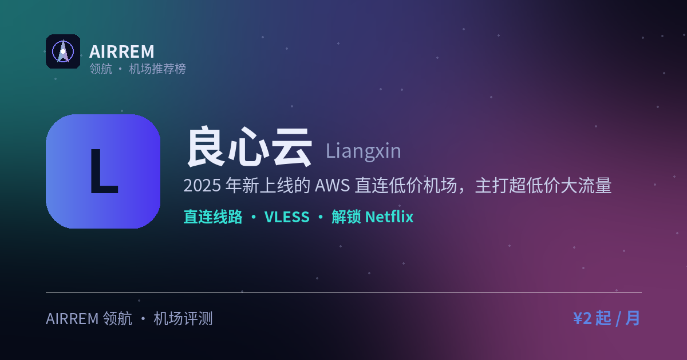

# 良心云机场评测 2026：低价尝鲜党，官网注册入口与套餐价格

> 一句话总结：低价大流量卷王：¥2/100G 起，带宽与设备数随档位一路涨到 10Gbps/100 台，AWS 直连新协议

👉 **[良心云 官网注册入口](https://t.rtxk.us/t/dedzags)** ｜ [完整评测与横向对比](https://555736.xyz/liangxin/)

---

## 基本信息

| 项目 | 内容 |
| --- | --- |
| 机场名称 | 良心云 |
| 成立时间 | 2025 |
| 线路类型 | AWS 直连线路 |
| 支持协议 | VLESS / Hysteria2 |
| 流媒体解锁 | Netflix / Disney+ / ChatGPT / TikTok |
| 节点地区 | 香港 · 日本 · 新加坡 · 韩国 · 美国 等 |
| 计费方式 | 包月 / 不限时买断 |
| 起步价格 | ¥2 / 月 100G |
| 推荐场景 | 想用超低价大流量套餐尝鲜 |

## 良心云是什么

良心云是 2025 年上线的新机场，定位「便宜、大流量、直连」，落地以 AWS 云服务器为主，覆盖港日新韩美等地区。

## 线路 · 协议 · 解锁

纯直连、链路结构简单，采用较新的 VLESS 与 Hysteria2；官方宣称解锁 Netflix、Disney+、TikTok、ChatGPT，个别协议长时间连接后可能断流。

- 纯直连（AWS 落地）
- 协议：VLESS / Hysteria2
- 注册即送少量试用流量

> 💡 直连机场波动是常态，建议以短期月付观察为主。

## 良心云 套餐价格

| 套餐 | 价格 | 说明 |
| --- | --- | --- |
| 100G 流量 | ¥2 | 月付 · 每月 100G · 1Gbps · 8 设备 |
| 500G 流量 | ¥4 | 月付 · 每月 500G · 2Gbps · 10 设备 |
| 1000G 王牌套餐 | ¥6 | 月付 · 每月 1000G · 3Gbps · 20 设备 |
| 5000G 流量 | ¥20 | 月付 · 每月 5000G · 4Gbps · 30 设备 |
| 10000G 团队套餐 | ¥30 | 月付 · 每月 10000G · 5Gbps · 50 设备 |
| 100000G 尊享套餐 | ¥260 | 月付 · 每月 100000G · 10Gbps · 100 设备 |
| 一次性 1000G | ¥21 | 买断 · 1000G 永久 · 1Gbps · 8 设备 |
| 一次性 5000G | ¥89 | 买断 · 5000G 永久 · 2Gbps · 10 设备 |
| 一次性 10000G | ¥149 | 买断 · 10000G 永久 · 3Gbps · 20 设备 |
| 一次性 20000G | ¥249 | 买断 · 20000G 永久 · 4Gbps · 30 设备 |
| 一次性 50000G 团队 | ¥499 | 买断 · 50000G 永久 · 5Gbps · 50 设备 |
| 一次性 100000G 尊享 | ¥888 | 买断 · 100000G 永久 · 10Gbps · 100 设备 |

> 价格取自官网购买页：月付按月重置流量，一次性为永久买断流量包；各档带宽与在线设备数随档位递增，以官网实时价格为准。

## 优点与缺点

**✅ 优点**

- 价格极低，流量单价有优势
- 协议较新，注册送试用流量
- 覆盖地区较全

**⚠️ 缺点**

- 2025 年新站，长期稳定性待观察
- 部分协议反馈存在断流
- 机场行业存在跑路风险，建议先用月付或小额套餐验证稳定性，别一上来就大额年付。

## 适合谁 / 不适合谁

| 👍 适合 | 👎 不适合 |
| --- | --- |
| 低成本轻度体验的用户 | 需要长期稳定、对 IP 纯净度要求高的用户 |
| 当备用机场使用 |  |

## 我们的结论

价格低、协议新（VLESS/Hy2），解锁反馈尚可；但运营时间短、直连机场普遍不稳定，强烈建议只用最低档月付观察，别直接年付。

## 常见问题

**Q：良心云可靠吗？**

A：新站价格低、协议新，但运营时间短，建议谨慎观察，先月付试用。

**Q：怎么开始？**

A：先用最低档月付测速与解锁，满意再加量，避免年付。

## 同类机场推荐

拿不定主意？可以再看看这几家同类型的：

- **[Mitce](https://555736.xyz/mitce/)** — 性价比 / 新手主推，¥4 起
- **[一分机场](https://555736.xyz/yifen/)** — 低价大流量，¥2 起
- **[顶级机场](https://555736.xyz/dingji/)** — 价格敏感重流量，¥5 起

全部 38 家机场的横向对比与选购方法论：**[信号塔 SignalTower · 机场大全](https://555736.xyz/airports/)**

---

数据更新：2026-07 ｜ 价格、套餐与优惠码以官网实时为准 ｜ 本仓库为第三方评测整理，与 良心云 官方无隶属关系 ｜ 请遵守当地法律法规使用网络服务。

关键词：良心云、直连机场、低价机场、VLESS、机场推荐
